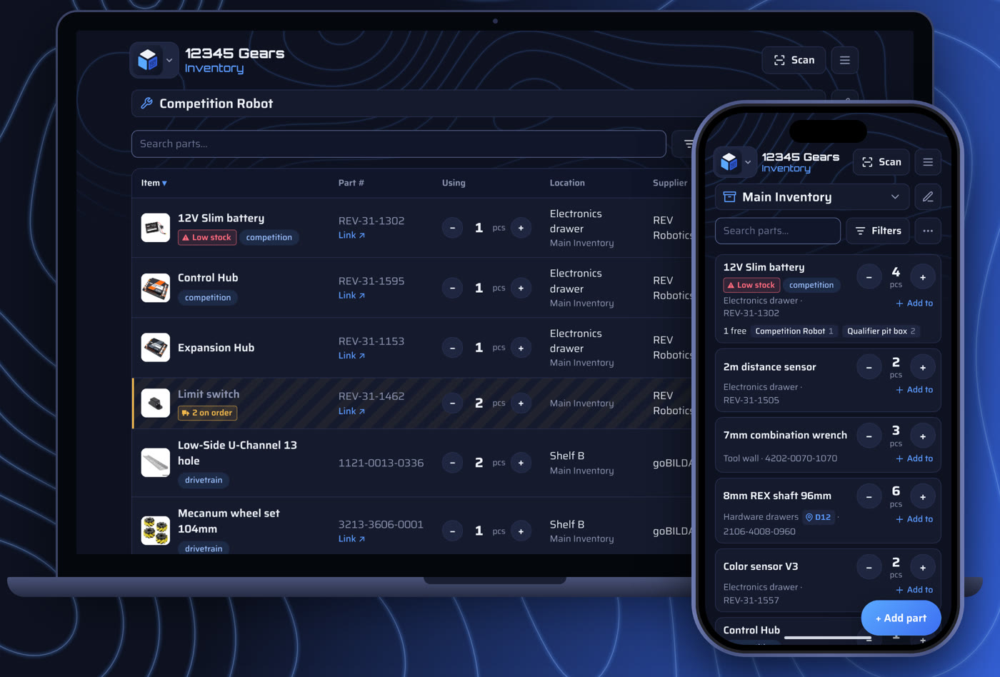

<h1><picture><source media="(prefers-color-scheme: dark)" srcset="docs/brand-dark.png"></picture></h1>

Track your team's parts on every teammate's phone and computer, with live updates.

<picture><source media="(prefers-color-scheme: dark)" srcset="docs/header/divider-dark.png"></picture>

## Get the app

- [Live demo](https://huskerthecat.github.io/FTC_Ultimate_Inventory/?demo)
- [Website](https://huskerthecat.github.io/FTC_Ultimate_Inventory/)
- [Windows installer](https://github.com/HuskerTheCat/FTC_Ultimate_Inventory/releases/latest/download/FTC-Ultimate-Inventory-Setup.exe)
- [Android app](https://github.com/HuskerTheCat/FTC_Ultimate_Inventory/releases/latest/download/FTC-Ultimate-Inventory.apk)
- [iPhone and iPad](https://huskerthecat.github.io/FTC_Ultimate_Inventory/setup.html#install-on-iphone-or-ipad)

<picture><source media="(prefers-color-scheme: dark)" srcset="docs/header/divider-dark.png"></picture>

## Guides

- [Team setup](https://huskerthecat.github.io/FTC_Ultimate_Inventory/setup.html)
- [How to use it](https://huskerthecat.github.io/FTC_Ultimate_Inventory/docs/how-to.html)
- [Quick start](https://huskerthecat.github.io/FTC_Ultimate_Inventory/docs/quick-start.html)
- [Troubleshooting](https://huskerthecat.github.io/FTC_Ultimate_Inventory/docs/troubleshooting.html)
- [Team admin](https://huskerthecat.github.io/FTC_Ultimate_Inventory/docs/admin.html)
- [Development](https://huskerthecat.github.io/FTC_Ultimate_Inventory/docs/development.html)
- [Privacy](https://huskerthecat.github.io/FTC_Ultimate_Inventory/privacy.html)

<picture><source media="(prefers-color-scheme: dark)" srcset="docs/header/divider-dark.png"></picture>

Copyright (C) 2026 HuskerTheCat. Licensed under the [GNU AGPL v3](LICENSE).
