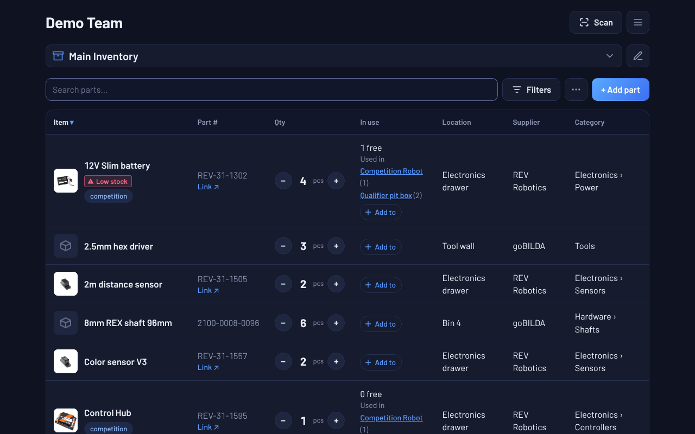
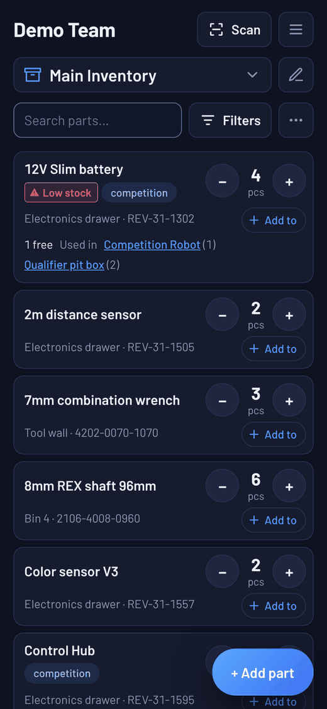
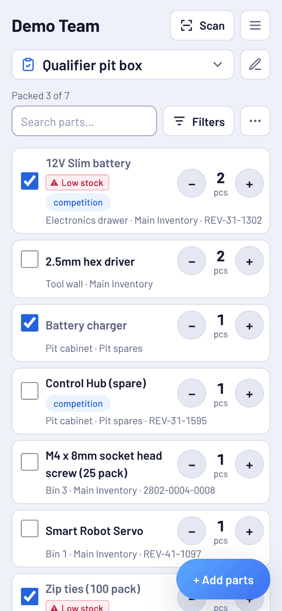
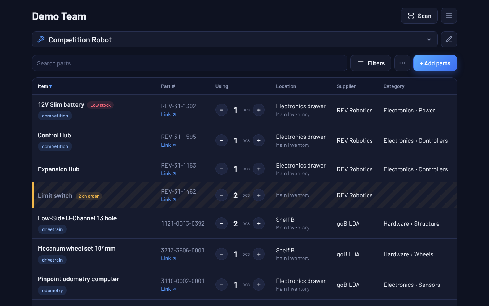
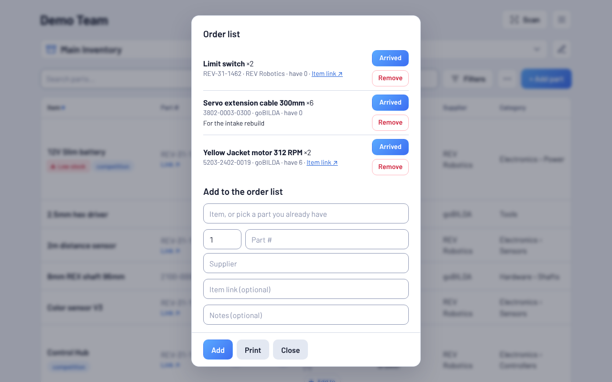
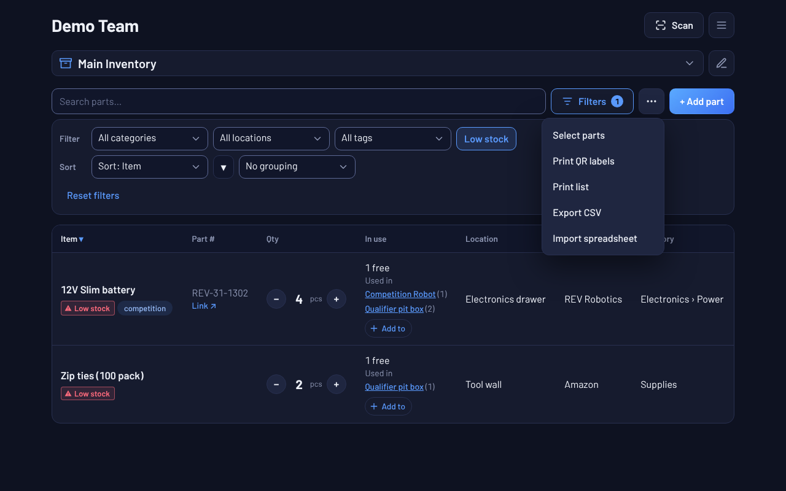

# FTC Ultimate Inventory

The ultimate inventory tool for FTC teams. Track each part's name, part number, quantity, location, supplier and category, with live updates across every teammate's device.

- **Inventories and projects:** keep several inventories, and make robot projects that pick parts from any of them. Each inventory shows how many of each part are free and which projects use it.
- **Packing lists:** list what to bring to a competition and check parts off as you pack them. Packed parts show as in use in the inventory until you uncheck them.
- **Order list:** keep track of parts on order. When one arrives, tap **Arrived** to add it to the inventory.
- **QR labels:** print labels for bins and parts, all at once or just the ones you pick. The app remembers which labels are printed, so new parts are easy to find. Scanning one with the app or a phone camera opens that bin or part.
- **Package barcodes:** scan the barcode on a goBILDA, REV, AndyMark, ServoCity, TETRIX or Studica package and the app fills in the part's name, part number, supplier, category and product link from a built-in catalog of their parts (works offline). Typing one of their part numbers fills in the rest the same way. Scanning a part you already have opens it. A barcode the catalog doesn't know is remembered on the part you add for it.
- **Organizing:** a fixed list of locations, units, condition, notes and a link on each part, a warning before adding a duplicate, grouping, sorting and a printable inventory sheet.
- **Low-stock alerts:** give a part a **Low stock at** number and it's flagged once the number free (not used by a project or packing list) drops to that number. The **Low stock** filter lists just those parts.
- **Subcategories and tags:** write categories like `Hardware/Screws` and tag parts (`spare`, `competition`) to filter by them.
- **Trash:** deleted parts, projects, packing lists and orders wait in **Trash** for 30 days, so they can be brought back.
- **Spreadsheet import and CSV export:** paste your parts straight from Excel or Google Sheets, whatever your columns are called, or save an inventory as a CSV file for a backup. Import only adds parts and skips ones already there.
- **Works offline:** no wifi at the venue? Keep editing. Changes are saved on the device and sync when it's back online. The website opens offline too, after it has been used online once.

- **Try it:** [live demo with sample parts](https://huskerthecat.github.io/FTC_Ultimate_Inventory/?demo), no setup needed. Changes aren't saved.
- **How to use it:** the [how-to guide](docs/HOW-TO.md) walks through every main feature with pictures.
- **Help:** [troubleshooting and FAQ](docs/TROUBLESHOOTING.md), a one-page [quick start](docs/QUICK-START.md) to print for the shop, and the [team admin guide](docs/ADMIN.md).
- **Web:** [huskerthecat.github.io/FTC_Ultimate_Inventory](https://huskerthecat.github.io/FTC_Ultimate_Inventory/) (works on ChromeOS, Mac, Linux and phones, and can be installed from Chrome or Edge)
- **Windows:** [download the installer](https://github.com/HuskerTheCat/FTC_Ultimate_Inventory/releases/latest/download/FTC-Ultimate-Inventory-Setup.exe)
- **Android:** [download the app](https://github.com/HuskerTheCat/FTC_Ultimate_Inventory/releases/latest/download/FTC-Ultimate-Inventory.apk)
- **iPhone and iPad:** [add the website to your Home Screen](SETUP.md#install-on-iphone-or-ipad)

Every team stores its data in its own free Firebase project. Setting a team up takes one person about 10 minutes: see the **[team setup guide](SETUP.md)**. Then share the **[how-to guide](docs/HOW-TO.md)** with your team: it walks through every main feature with pictures.

## Screenshots



<p>
  
  
</p>







## How it works

The app is one plain JavaScript web app (`src/`). Electron wraps it for Windows (`electron/`) and Capacitor wraps it for Android, so all three look and work the same. The app talks directly to the team's Firebase project: Firebase Auth for sign-in and Firestore for the parts list. [`firestore.rules`](firestore.rules) only lets team members read or write, and a teammate can only join with the team secret inside the join code.

The supplier catalog ([`src/catalog.json`](src/catalog.json)) is built from the product data each supplier publishes on its own store by [`.github/scripts/build-catalog.mjs`](.github/scripts/build-catalog.mjs). The **Update part catalog** workflow rebuilds it on the 1st of each month and republishes the website; run it from the Actions tab to update sooner. Windows and Android apps get the new catalog with their next build.

## Privacy

Everyone must accept the [privacy policy](PRIVACY.md) to join a team. The app only logs each new team's name and number and any bug reports and feature requests to a central server. It is a separate Firebase project ([`src/hub.js`](src/hub.js), rules in [`hub.rules`](hub.rules)). Nothing about individual users is sent.

## Development

```sh
npm install
npm run dev          # web app at http://localhost:5173
npm run emulators    # local Firebase (needs Java)
npm run desktop      # run the Windows/desktop app
```

To use the local emulators, create a team with any config whose `projectId` starts with `demo-`, for example:

```
apiKey: "x", authDomain: "x", projectId: "demo-inventory", appId: "x"
```

Pushing to `main` publishes the website. Running the **Build apps** workflow from the Actions tab builds the Windows installer and Android APK and attaches them to a release.

## License

Copyright (C) 2026 HuskerTheCat. Licensed under the [GNU AGPL v3](LICENSE): anyone who shares or hosts a modified version, including as a website, must publish its source code under the same license.
