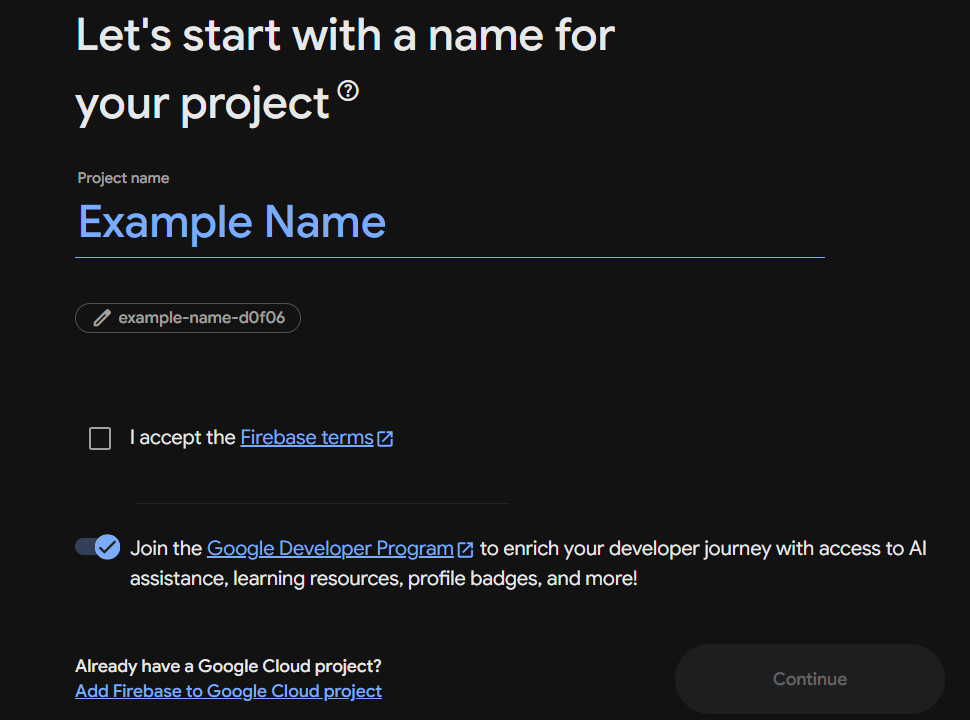
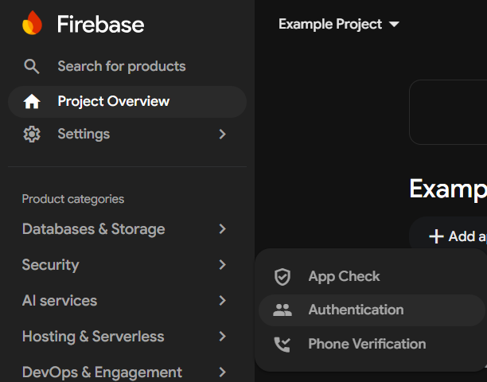
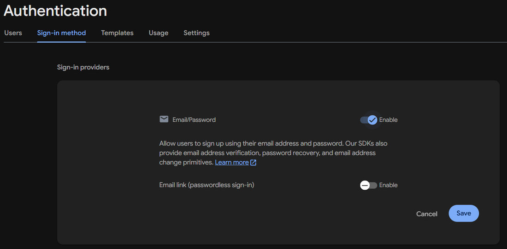
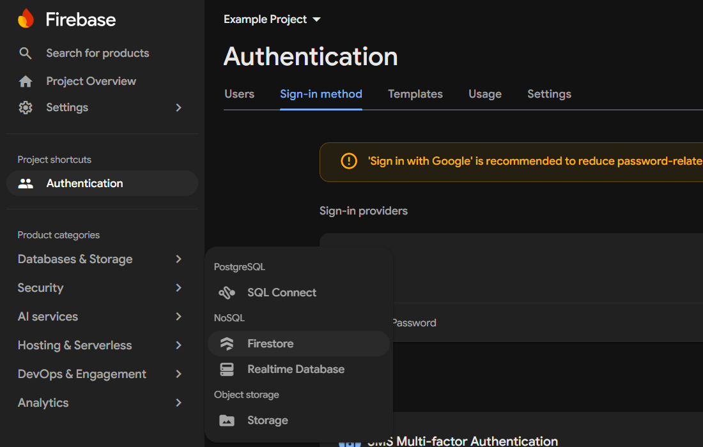
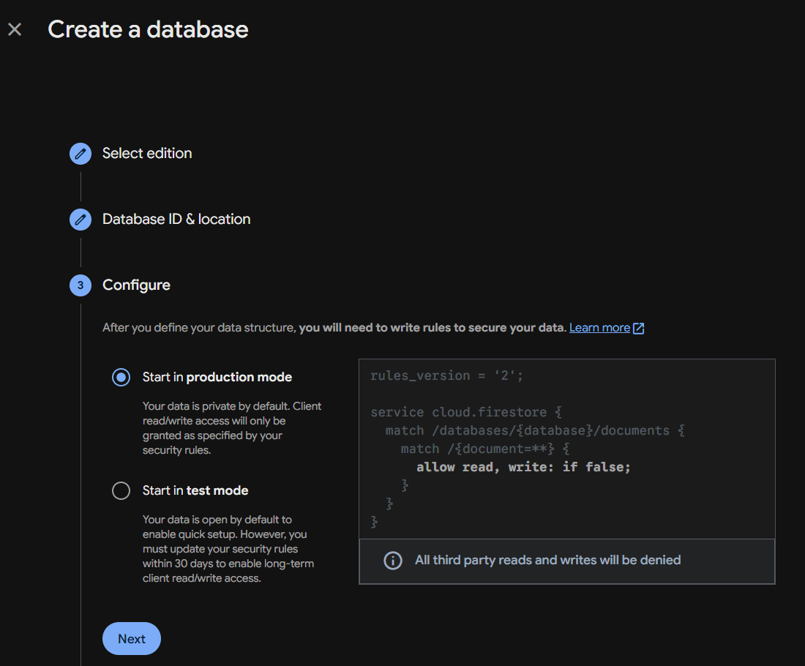
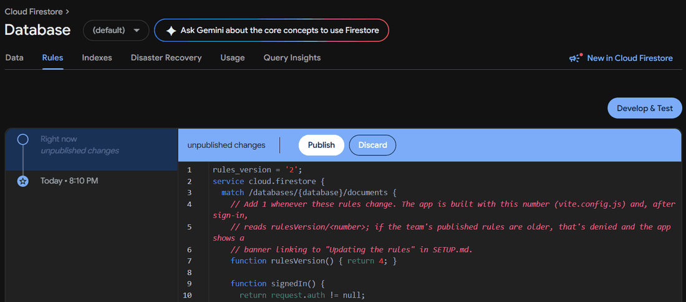
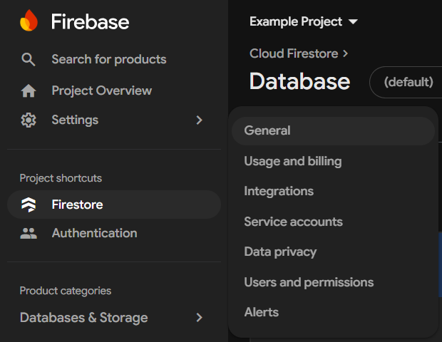
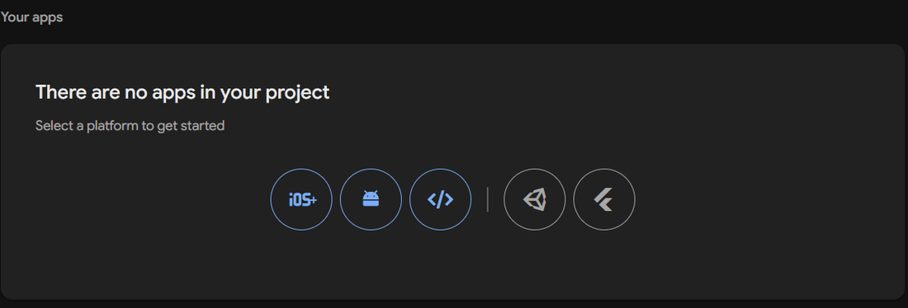
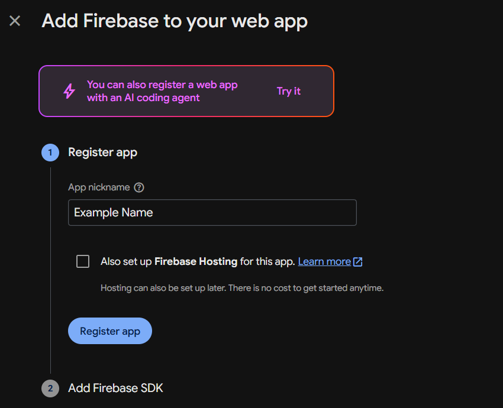
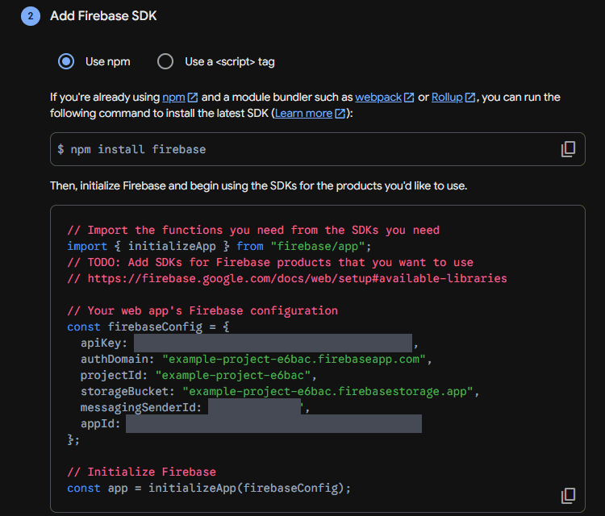

<h1><picture><source media="(prefers-color-scheme: dark)" srcset="docs/header/setup-dark.png"></picture></h1>

One person per team does this once, in about 10 minutes. Everyone else only needs the join link. Once your team is set up, the [how-to guide](docs/HOW-TO.md) shows everyone how to use the app.

Your team gets its own free Firebase project, so your inventory, logins and usage are completely separate from every other team. The free plan (Spark) has no credit card attached, so it can never charge you.

## 1. Create a Firebase project

1. Go to [console.firebase.google.com](https://console.firebase.google.com) and sign in with a Google account the team can keep (a team or coach account works well).
2. Click **Get started by setting up a Firebase project** (or **Create a project**), name it (for example `example-team-12345`), tick **I accept the Firebase terms** and click **Continue**. Google Analytics is not needed: switch it off and click **Create project**.
   Your project ID (shown under the name) becomes the start of your join code, so a short one keeps the code short.

   

## 2. Turn on email sign-in

1. In the left menu, open **Security → Authentication** and click **Get started**.

   

2. On the **Sign-in method** tab, choose **Email/Password**, switch on the first toggle, and click **Save**.

   

## 3. Create the database

1. Open **Databases & Storage → Firestore** (under NoSQL) and click **Create database**. Use Firestore, not Realtime Database.

   

2. Choose **Standard edition**, leave the database ID as **(default)**, pick a location close to you, and choose **Start in production mode**.

   

3. Copy the app's rules: open the app ([web version](https://huskerthecat.github.io/FTC_Ultimate_Inventory/), or the Windows or Android app), click **Start setup** under **Set up a new team**, then **Copy rules**.
4. Back in Firebase, open the database's **Rules** tab, delete everything there, paste the rules, and click **Publish**.

   

These rules are what keep your inventory private: only people who joined with your team's code can read or change it.

## 4. Copy your connection info

1. In the left menu, open **Settings → General** and scroll down to **Your apps**.

   

2. Click the web icon (`</>`), give it any nickname, and click **Register app**. Leave Firebase Hosting unticked.

   

   

3. Copy the code block it shows you with its copy button (bottom right). The app only reads the `firebaseConfig = { ... }` part, so copying the whole block is fine.

   

## 5. Create your team in the app

1. On the app's **Set up a new team** screen, enter your team name and number, paste the block you copied, and click **Create team**.
2. The app checks your Firebase project first. If a step above was missed, it says which one, with a **Fix it in Firebase** link to the right page. Fix it, then click **Create team** again.
3. Enter your name, email and a password, and click **Create account**.
4. Open the link in the email Firebase sends you (check spam if it's not there). The app moves on by itself, and you are now the team's first member.

## 6. Invite your team

Click **Team**. Teammates can scan the QR code or open the link on any device, or in the Windows, Android or iPhone app choose **Scan QR** under **New to the team?** (or type the short join code, for example `example-team-12345-k7qm3x9p2r`). Then they create an account, open the link in the email Firebase sends them, and they're in. To use the same account on another phone or computer, choose **Sign in to your team**, pick your program and enter your team number, then sign in with the same email and password.

Only share the join code with your team: anyone who has it can join. As the team owner, you can remove people from the same **Team** screen. Removing someone also makes a new join code, so their old one stops working. If a code ever gets shared by mistake, use **Reset join code**.

Then send your team the [how-to guide](docs/HOW-TO.md). It walks through every main feature with pictures. Keep the [team admin guide](docs/ADMIN.md) for later: it covers removing members, backups and handing the team to a new admin.

## Install on iPhone or iPad

There is no App Store app. Instead, the website installs like an app, with its own icon and full screen:

1. Open the [web version](https://huskerthecat.github.io/FTC_Ultimate_Inventory/) in **Safari**.
2. Tap the **Share** button (the square with an arrow pointing up).
3. Scroll down and tap **Add to Home Screen**, then tap **Add**.
4. Open the app from the new icon on your Home Screen.

Then scan your team's join QR code with **Scan QR** in the app, or paste the join code. The Home Screen app keeps its own sign-in separate from Safari, so join from the app itself rather than from the link in Safari.

## Updating the rules

When a new version of the app needs newer rules, it shows a blue **Your Firebase rules are out of date** banner. **Updating the rules must be done by your team's admin**, the person who set up the team's Firebase project. If that's not you, send your admin a link to this section. Updating the rules doesn't change any of your team's data, and the app keeps working with the old rules in the meantime. New features will not work until your rules are updated.

If the app shows a red **Your Firebase is configured incorrectly and your account is not secure** banner instead, your project isn't using the app's rules (for example, it was created in test mode), so anyone could read your inventory and your members' emails. Follow the same steps right away.

On a computer:

1. Click the banner in the app, then **Copy rules**.
2. Click **Open your Firebase rules** and sign in with the Google account that owns your team's project.
3. Click in the rules editor, select everything (Ctrl+A, or Cmd+A on a Mac), and press Delete.
4. Paste the rules you copied (Ctrl+V, or Cmd+V) and click **Publish**.
5. Wait a minute, then close and reopen the app (or refresh the web page). The banner is gone once the new rules are in use.

Teams set up before short join codes: after publishing the new rules, open **Team** and use **Reset join code** once to get a short code. People already on the team stay signed in.
