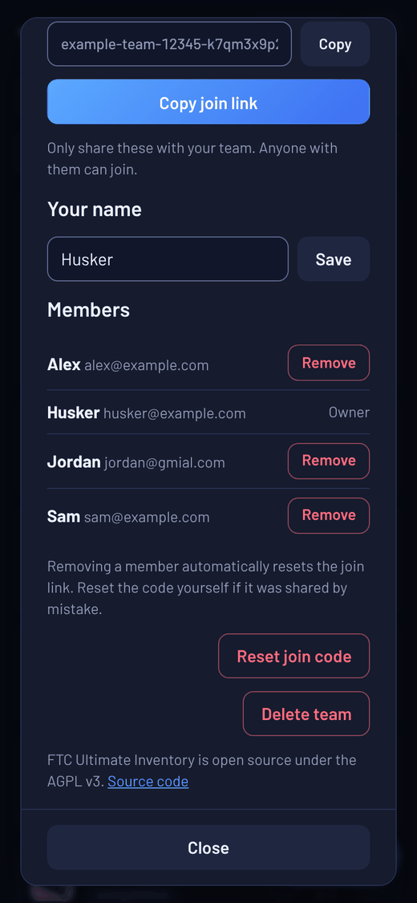

# Team admin guide

For the person who runs the team's inventory: the one who set up the team in the app, shown as **Owner** in the Members list. Setting up a new team is covered in the [team setup guide](../SETUP.md), and everyday use in the [how-to guide](HOW-TO.md).

Everything below is on the **☰ → Team** screen unless it says otherwise. Teammates see the same screen without the owner buttons.

**Contents**

1. [Invite teammates](#1-invite-teammates)
2. [Keep the Members list clean](#2-keep-the-members-list-clean)
3. [Reset the join code](#3-reset-the-join-code)
4. [Update the Firebase rules](#4-update-the-firebase-rules)
5. [Back up with CSV](#5-back-up-with-csv)
6. [Hand the team to a new admin](#6-hand-the-team-to-a-new-admin)
7. [Delete the team](#7-delete-the-team)

---

## 1. Invite teammates

Open **☰ → Team**. New teammates scan the QR code on your screen, or you send them the join code or the join link (use the **Copy** buttons). They join, create an account, and they're in. The [setup guide](../SETUP.md#6-invite-your-team) has the details.

- Every member can open **Team** and share the code, not just you.
- Only share it with your team: anyone who has it can join. Don't post it anywhere public, like a team website or a Discord server others can see.
- Someone who already joined uses **Sign in to your team** with your program and team number on a new device. They don't need the code again.

---

## 2. Keep the Members list clean

Check the Members list every so often, and at least at the end of each season:

- **Remove people who've left**, especially graduates who signed up with a school email.
- **Remove emails that look wrong**, like `jordan@gmial.com` above. New members confirm their email when they join, but people who joined before the app checked emails didn't. Whoever ends up with a wrong or old inbox (a typo'd address someone else registers, or a school address given to a new student later) could use **Forgot password?** and get into your team. If the person is real, ask them to join again with the right email.

To remove someone, tap **Remove** next to their name. This:

- signs them out on all their devices and shows them **You no longer have access** to the team,
- makes a new join code, so the old code can't get them back in,
- keeps their entries in the change log.

Their account still exists in your Firebase project but can't see anything. To erase it completely, open the [Firebase console](https://console.firebase.google.com), go to **Security → Authentication → Users**, and delete their account there.

Removed someone by mistake? Send them the new join code. They join again and use **Sign in** (not **Create account**) with their old password, unless you deleted their account.

---

## 3. Reset the join code

If the join code or link was shared somewhere it shouldn't be, tap **Reset join code**. The old code, link and QR code stop working right away.

People already on the team stay signed in; only new teammates need the new code. If you printed the QR code and posted it in your shop, print the new one.

---

## 4. Update the Firebase rules

When a new version of the app needs newer security rules, everyone on the team sees a blue **Your Firebase rules are out of date** banner. Only the person who owns your team's Firebase project can fix it. Tap the banner: it has a **Copy rules** button and a link straight to your project's rules. [Updating the rules](../SETUP.md#updating-the-rules) in the setup guide has the full steps. It doesn't change any of your data, and the app keeps working until you do it.

A red **Your Firebase is configured incorrectly and your account is not secure** banner means your project isn't using the app's rules at all, so anyone could read your inventory. Follow the same steps right away.

---

## 5. Back up with CSV

Your inventory is stored safely in your Firebase project, and deleted items stay in **☰ → Trash** for 30 days. A CSV backup protects against bigger mistakes, like a bulk edit gone wrong or a deleted Firebase project.

In each inventory, choose **⋯ → Export CSV** (on the website or the Windows app; the Android app can't save files). Do it before each season and after a big inventory count, and keep the files somewhere the team can find them, like a shared drive.

A CSV holds each part's details (item, part number, quantity, low-stock number, unit, location, supplier, category, tags, condition, barcode, link and notes). It doesn't include projects, packing lists, orders, the change log or the trash.

To bring parts back from a backup, open an inventory, choose **⋯ → Import spreadsheet** and then **Choose CSV file**. Parts already in that inventory (same name or part number) are skipped, so nothing you have is changed. See [Import and export](HOW-TO.md#9-import-and-export).

---

## 6. Hand the team to a new admin

Before you graduate or step down, hand over two things.

**The Firebase project.** If it's under your own Google account, add the new admin to it: in the [Firebase console](https://console.firebase.google.com), open the project, open **Settings → Users and permissions**, click **Add member**, enter their Google email, pick the **Owner** role and click **Add member**. A team or coach Google account avoids this step in future.

**The owner role in the app.** This is done in the Firebase console too, once the new admin has joined the team in the app:

1. In the Firebase console, open **Databases & Storage → Firestore** and the **Data** tab.
2. Open the **members** collection and click through the documents until you find the one whose **email** is the new admin's. Copy its document ID (the long code at the top).
3. Open the **team** collection, then the **info** document. Hover over the **owner** field, click its pencil icon, paste the new admin's ID in place of the old one, and click **Update**. Don't change the other fields.
4. The new admin closes and reopens the app. They now see **Owner** next to their name, and the **Remove**, **Reset join code** and **Delete team** buttons.

The new admin can then remove the old admin's account from Members if they're leaving.

The same steps work if the owner's account is lost (for example, a school email that was closed). Anyone who can open the Firebase project can make another member the owner.

---

## 7. Delete the team

Only do this if your team is done with the app for good. If you just want a fresh start, delete parts or inventories instead.

1. Export a CSV of each inventory first if you might want the data later.
2. Open **☰ → Team** and tap **Delete team**.
3. Type your team number to confirm, for example `FTC 12345`. You can add a reason; it's logged to a central server, so please don't include personal info.

This takes your team off the central team list, so nobody can sign in with your team number, and this device leaves the team. **It doesn't erase anything in your Firebase project**: teammates can still open the inventory until you delete the project. To erase the inventory and everyone's accounts, open your Firebase project's **Settings → General**, scroll to the bottom and click **Delete project**. The app shows a link to it after you delete the team.
