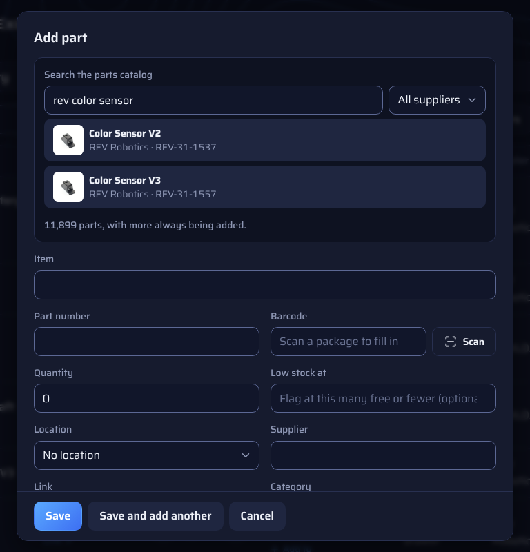
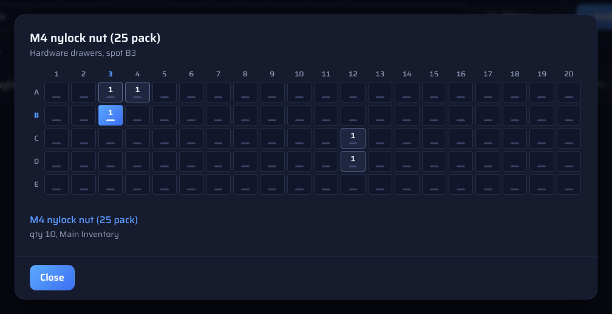
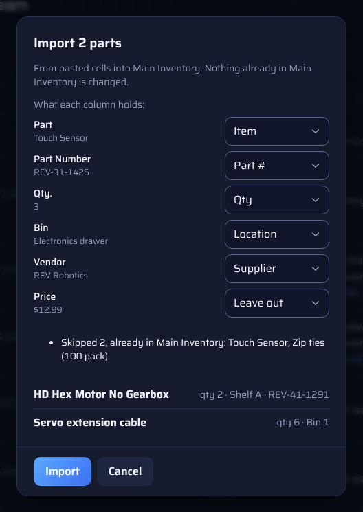
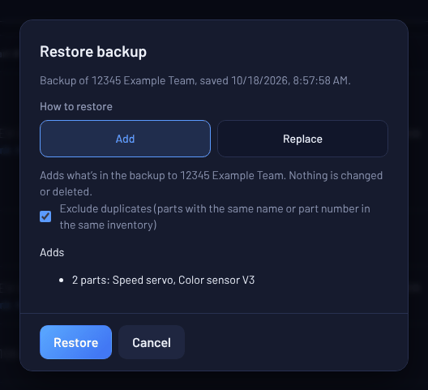

<h1><picture><source media="(prefers-color-scheme: dark)" srcset="header/how-to-dark.png"></picture></h1>

The basics and the most useful features. Follow along in the [demo](https://huskerthecat.github.io/FTC_Ultimate_Inventory/?demo), no setup needed.

The website, Windows app and Android app work the same. On a phone, the parts table becomes cards.

Something wrong? [Troubleshooting and FAQ](TROUBLESHOOTING.md). Running the team? [Team admin guide](ADMIN.md). Shop poster: [quick start](QUICK-START.md).

**Contents**

1. [Get into your team](#1-get-into-your-team)
2. [Find your way around](#2-find-your-way-around)
3. [Add and change parts](#3-add-and-change-parts)
4. [Find parts fast](#4-find-parts-fast)
5. [Locations and QR labels](#5-locations-and-qr-labels)
6. [Inventories, projects and packing lists](#6-inventories-projects-and-packing-lists)
7. [Order list](#7-order-list)
8. [Edit many parts at once](#8-edit-many-parts-at-once)
9. [Import, export and backups](#9-import-export-and-backups)
10. [Change log, Undo and Trash](#10-change-log-undo-and-trash)
11. [Team, sign out and other tips](#11-team-sign-out-and-other-tips)

---

<picture><source media="(prefers-color-scheme: dark)" srcset="header/divider-dark.png"></picture>

## 1. Get into your team

Get the app from the [README](../README.md). On an iPhone or iPad, [add the website to your Home Screen](../SETUP.md#install-on-iphone-or-ipad).

The first screen has three ways in:

- **Sign in to your team**: you have an account and you're on a new device. Pick your program, enter your team number, then sign in.
- **New to the team?**: you're new. Paste the join code from your admin, or tap **Scan QR** and scan the team's QR code. The join link does the same.
- **Set up a new team**: one person per team, once. See the [team setup guide](../SETUP.md).

After joining, enter your name (shown in the change log), email and a password, tick the privacy policy box and tap **Create account**. Open the link in the email you get; the app carries on by itself. Next time, just **Sign in**.

A new team's inventory starts with **Add your first parts** and buttons to add a part, scan a package, import a spreadsheet, add locations and invite your team.

> **Admins:** to invite people, open **☰ → Team** and share the QR code, join code or link. Anyone who has them can join. More in the [team admin guide](ADMIN.md).
>
> 

---

<picture><source media="(prefers-color-scheme: dark)" srcset="header/divider-dark.png"></picture>

## 2. Find your way around

1. **List picker.** Switch between inventories, projects and packing lists, or make a new one.
2. **Rename or delete** the inventory, project or list you're looking at.
3. **Scan.** Scan a QR label to open that bin or part, or a supplier package barcode to find or add that part. A part you already have opens with big **−** and **+** buttons, so taking one or putting some back is two taps; **Edit part** opens everything else.
4. **☰ menu.** Orders, Locations, Change log, Trash, Export backup, Restore backup, Team, Report bug, Request feature, Pain and suffering mode and Sign out.
5. **Search** by name, part number, barcode, supplier, location, category, condition or notes. Each word can match anywhere, so `m4 screw` finds *M4 x 8mm socket head screw*.
6. **Filters.** Filter, sort and group the list.
7. **⋯ menu.** Select parts, Print QR labels, Print list, Export CSV and Import spreadsheet.
8. **Add part.**
9. **− and +** change the quantity by one.
10. **Add to** puts the part in a project or packing list. **In use** shows how many are free, with a chip for each project using the part. Tap a chip to open that project.
11. **Badges** (square, with an outline) flag parts that are **Low stock**, **on order**, used or broken. The round chips next to them are the part's tags; click one to show only parts with that tag.

Click a part to open and edit it. On a computer, click a column heading to sort, and again to reverse.

On a phone, each part is a card. **+ Add part** floats at the bottom right.

  
  

---

<picture><source media="(prefers-color-scheme: dark)" srcset="header/divider-dark.png"></picture>

## 3. Add and change parts

Tap **+ Add part**. Quickest: **Search the parts catalog** at the top, type a few words or a part number, like `u-beam 8mm`, and tap the part. It covers goBILDA, REV, AndyMark, ServoCity, TETRIX, Studica, SWYFT, Axon and Limelight; the menu next to the search narrows it to one supplier.

The name, part number, supplier, category and link fill in, plus the supplier's photo when online. Add the quantity and location, then **Save**. Only the name and quantity are required, so parts not in the catalog are just typed in. To ask for one to be added, tap **Request a part here** under the search.

- **Part number or barcode:** typing one of those suppliers' part numbers fills in the rest. Or tap **Scan** next to Barcode and scan the package.
- **Low stock at** (optional) flags the part at that quantity or below.
- **Location** comes from your team's list ([section 5](#5-locations-and-qr-labels)). **+ New location…** adds one on the spot.
- **Category** can have subcategories: `Electronics/Sensors` shows as Electronics › Sensors.
- **Tags** are short labels like `spare` or `competition`. Tap one to show only parts with it.
- **More details** holds unit, condition and notes.
- **Save and add another** keeps the location, category and tags, handy for a whole bin.
- Filtered to one location, or just scanned a bin? **+ Add part** starts there.

The app warns you about a duplicate name or part number.

To change a part, tap it, edit and **Save**. For just the quantity, use **−** and **+** on the list. **Delete** is at the bottom of the dialog and goes to [Trash](#10-change-log-undo-and-trash).

---

<picture><source media="(prefers-color-scheme: dark)" srcset="header/divider-dark.png"></picture>

## 4. Find parts fast

**Search** narrows the list as you type. Matches in your other inventories show under the list (*Also found in Pit spares (2)*); tap to search there. **Filters** has more:

- **Filter** by category, location or tag, or tap **Low stock** to see only parts that need restocking.
- **Sort** by any column, or by **Recently changed**.
- **Group** by category, location or supplier.

The Filters button shows how many are on. **Reset filters** clears them.

---

<picture><source media="(prefers-color-scheme: dark)" srcset="header/divider-dark.png"></picture>

## 5. Locations and QR labels

Your team has one list of locations (bins, shelves, drawers). **☰ → Locations** adds, renames and deletes them (only empty ones) and prints a bin's label.

### Storage grids

For a cabinet of small drawers or a shelf of bins, use **Add grid storage**: type a name and its size as rows x columns, like 4x7, then tap **Create**. Spots are named by row and column: A1 is the top left, C12 the third row, twelfth column. **Edit grid** changes the size later; the app won't make it smaller while a spot it would cut off still has parts.

In a part's dialog, pick the grid location, then tap the part's spot. In the list, the part shows its spot by its location. Tap that spot, or **Find part** in the part's dialog or after scanning its label, to see the grid with it highlighted. Tapping any spot in a grid lists what's in it.

**⋯ → Print QR labels** prints labels for bins and parts. Scanning one with **Scan** or any phone camera opens that bin or part, ready to take one with **−**.

The app remembers which labels are printed, so only new ones are checked. The list follows your filters, so filter to one location to print just its labels. A part's dialog has **Print label** for one.

---

<picture><source media="(prefers-color-scheme: dark)" srcset="header/divider-dark.png"></picture>

## 6. Inventories, projects and packing lists

Use the **list picker** at the top to switch views or make a **New inventory, project or list**.

  
  

- **Inventory**: holds parts. Teams start with **Main Inventory** and can add more (like *Pit spares*).
- **Project**: the parts a robot or build uses, from any inventory. They stay in their inventory but show as **in use**, so you see how many are free.
- **Packing list**: what to bring to a competition. Check parts off as you pack; only checked parts count as in use (*Packed 3 of 7*). **⋯ → Unpack all** unchecks everything after an event (it asks first).

In a project or packing list, **+ Add parts** lists every part in every inventory; tap one to add one more, or **−** to take one back. **−** and **+** change how many it uses; tap the part to type a number or remove it.

In the inventory, **Add to** on a part sends it to a project or packing list.

  
  

---

<picture><source media="(prefers-color-scheme: dark)" srcset="header/divider-dark.png"></picture>

## 7. Order list

Open **☰ → Orders** to track parts you've ordered.

- Add an order by typing the item or picking a part you have. A supported part number fills in the rest. Link and notes are optional.
- New items appear in Main Inventory right away as **on order**, so projects and packing lists can use them early.
- When it arrives, tap **Arrived** to add it to the inventory. If only some came, enter how many; the rest stays on the list.
- Tap an order to change it. **Print** prints the list.

---

<picture><source media="(prefers-color-scheme: dark)" srcset="header/divider-dark.png"></picture>

## 8. Edit many parts at once

**⋯ → Select parts**, tap the parts (or **Select all shown** for everything your search and filters show), then **Edit selected**. Set location, category, low-stock number and tags for all at once. Anything left on "Keep" stays as is.

---

<picture><source media="(prefers-color-scheme: dark)" srcset="header/divider-dark.png"></picture>

## 9. Import, export and backups

Keep your parts in a spreadsheet? Import them whatever the columns are called.

1. In Excel or Google Sheets, copy your parts along with the row of column names.
2. In the app, open the inventory, choose **⋯ → Import spreadsheet** and paste. Or choose a CSV file.
3. Check each column's menu (**Item**, **Qty**, **Location**…). Fix any it got wrong and pick **Leave out** for ones you don't need, like prices. Some column must be **Item**.
4. Click **Import**.

Rows the app can't add are listed with the reason (*250 pcs* and *1,200* are fine as quantities). Parts already there (same name or part number) are skipped, so importing twice adds nothing. **Undo** removes the whole import.

**Export CSV** (same menu) saves the inventory as a spreadsheet file, on the website and Windows app but not Android. **Print list** prints what's on screen.

### Back up the whole team

**☰ → Export backup** saves everything in one `.inv` file: inventories, projects, packing lists, parts, orders, locations and which QR labels are printed. Not members, the change log or the trash. Works on the website and Windows app, not Android. Keep it on a shared drive.

**☰ → Restore backup** opens a `.inv` file, then you pick how. The app lists what each way will do before anything changes.

- **Add** brings in what the team doesn't have, like parts deleted since. Nothing you have changes. **Exclude duplicates** (on by default) skips parts with the same name or part number in the same inventory; turn it off to add them again as copies.
- **Replace** makes the team match the backup: adds what's missing, resets quantities, names and inventories, and removes what isn't in the backup. Removed items go to [Trash](#10-change-log-undo-and-trash) for 30 days. You type your team number first (or the team name, if you joined with a code or link).

A new, empty team skips the choice. IDs are kept, so printed QR labels still work, even in a new Firebase project. Restoring needs internet.

---

<picture><source media="(prefers-color-scheme: dark)" srcset="header/divider-dark.png"></picture>

## 10. Change log, Undo and Trash

- **Undo** shows at the bottom for a few seconds after most changes.
- **☰ → Change log** shows who changed what, and when.
- **☰ → Trash** keeps deleted items for 30 days. Tap **Restore** to bring one back. Only the owner can **Delete forever**.

  
  

---

<picture><source media="(prefers-color-scheme: dark)" srcset="header/divider-dark.png"></picture>

## 11. Team, sign out and other tips

- **☰ → Team** shows the join QR code and code, lets you change your name, and lists members. Owners can remove members, **Reset join code** and delete the team ([admin guide](ADMIN.md)).
- **Works offline.** Edits are saved on the device and sync when you're back online. The website opens offline after one online visit.
- **Changes show live**, so two people can count at once.
- **Banner you don't understand?** See [Troubleshooting and FAQ](TROUBLESHOOTING.md). For a blue rules banner, your admin needs to [update the rules](../SETUP.md#updating-the-rules).
- **☰ → Report bug** and **☰ → Request feature** send a note to the developer with your team name and app version. Keep personal info out.
- **☰ → Pain and suffering mode** switches to a light theme; turn it off for Normal mode. Each device remembers its choice.
- **☰ → Sign out** also removes the team's data from that device, good practice on a shared computer.
