# How to use FTC Ultimate Inventory

A walkthrough of the basics and the most useful features, for everyone on the team. The pictures come from the [demo](https://huskerthecat.github.io/FTC_Ultimate_Inventory/?demo), so you can follow along there without setting anything up.

The website, the Windows app and the Android app all look and work the same. On a phone, the parts table turns into cards, but every button is still there.

Something not working? See [Troubleshooting and FAQ](TROUBLESHOOTING.md). Running the team? See the [team admin guide](ADMIN.md). For a one-page sheet to post in the shop, print the [quick start](QUICK-START.md).

**Contents**

1. [Get into your team](#1-get-into-your-team)
2. [Find your way around](#2-find-your-way-around)
3. [Add and change parts](#3-add-and-change-parts)
4. [Find parts fast](#4-find-parts-fast)
5. [Locations and QR labels](#5-locations-and-qr-labels)
6. [Inventories, projects and packing lists](#6-inventories-projects-and-packing-lists)
7. [Order list](#7-order-list)
8. [Edit many parts at once](#8-edit-many-parts-at-once)
9. [CSV export and import](#9-csv-export-and-import)
10. [Change log, Undo and Trash](#10-change-log-undo-and-trash)
11. [Team, sign out and other tips](#11-team-sign-out-and-other-tips)

---

## 1. Get into your team

Get the app from the [README](../README.md): use the website, or install the Windows or Android app. On an iPhone or iPad, [add the website to your Home Screen](../SETUP.md#install-on-iphone-or-ipad).

The first screen has three ways in:

- **Sign in to your team**: you already have an account and you're on a new device. Pick your program, enter your team number, then sign in with your email and password.
- **Join a team**: you're new. Paste the join code your team admin sent you, or tap **Scan QR** and point the camera at the team's join QR code. Opening the join link does the same thing.
- **Set up a new team**: only one person per team does this, once. It lists the setup steps and checks your Firebase project before creating the team. The [team setup guide](../SETUP.md) has each step in detail.

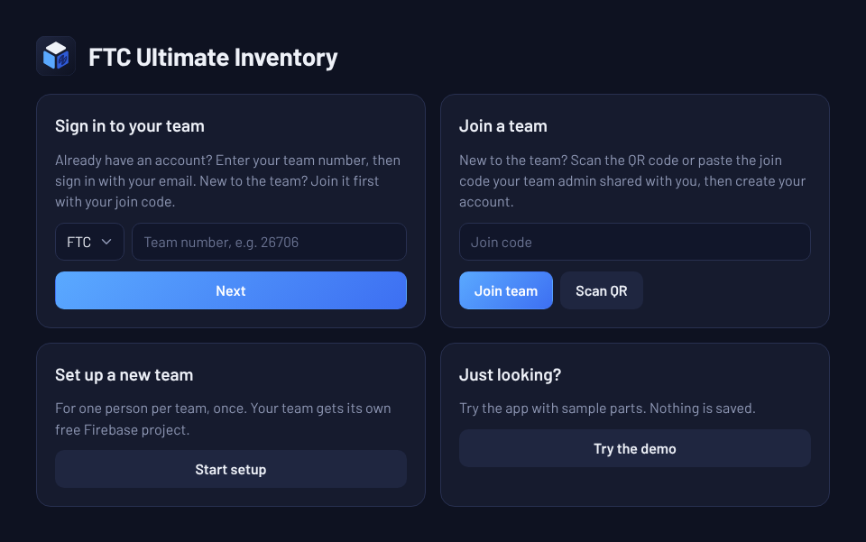

After joining, enter your name, email and a password, tick the privacy policy box, and tap **Create account**. Your name is what teammates see in the change log. Then open the link in the email you get, and the app carries on by itself. This only happens once. Next time, just **Sign in**.

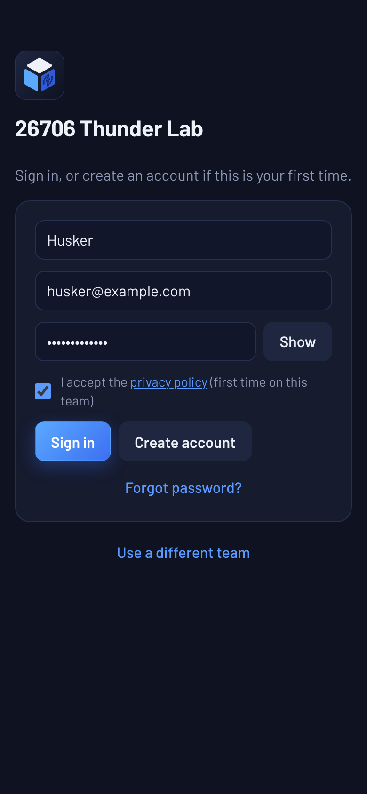

A brand-new team's inventory is empty, so it shows **Add your first parts** with buttons to add a part, scan a package, import a CSV file, add locations and invite your team.

> **Admins:** to invite people, open **☰ → Team**. Teammates scan the QR code on your screen, or you send them the join code or link. Only share these with your team: anyone who has them can join. The [team admin guide](ADMIN.md) covers the rest of running the team.
>
> 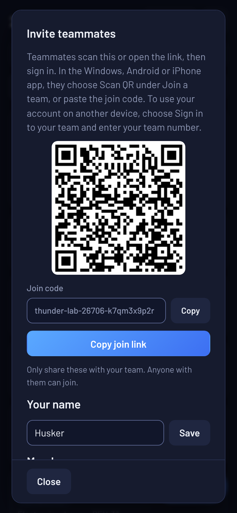

---

## 2. Find your way around

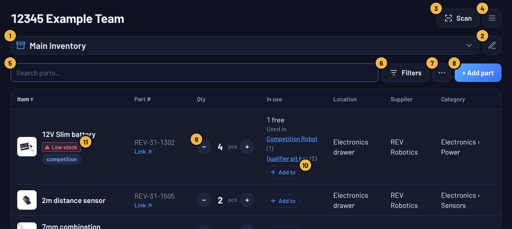

1. **List picker.** Switch between inventories, projects and packing lists, or make a new one.
2. **Rename or delete** the inventory, project or list you're looking at.
3. **Scan.** Scan a QR label to open that bin or part, or a supplier package barcode to find or add that part. A part you already have opens with big **−** and **+** buttons, so taking one or putting some back is two taps; **Edit part** opens everything else.
4. **☰ menu.** Orders, Locations, Change log, Trash, Team, Report bug, Request feature, Pain and suffering mode and Sign out.
5. **Search** by name, part number, barcode, supplier, location, category, condition or notes. Each word can match anywhere, so `m4 screw` finds *M4 x 8mm socket head screw*.
6. **Filters.** Filter, sort and group the list.
7. **⋯ menu.** Select parts, Print QR labels, Print list, Export CSV and Import CSV.
8. **Add part.**
9. **− and +** change the quantity by one.
10. **Add to** puts the part in a project or packing list. Above it, **In use** shows how many are free and which projects use the part.
11. **Badges** (square, with an outline) flag parts that are **Low stock**, **on order**, used or broken. The round chips next to them are the part's tags; click one to show only parts with that tag.

Click a part's name (or anywhere on its row) to open and edit it. On a computer, click a column heading to sort by it, and click it again to reverse the order.

On a phone, each part is a card with its location and part number under the name. **+ Add part** floats at the bottom right, and the ☰ menu holds the same items.

  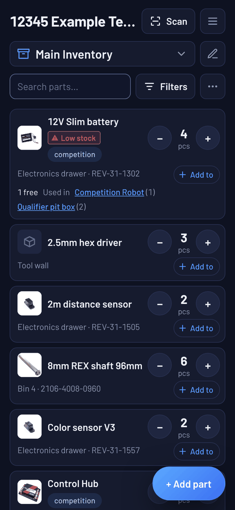
  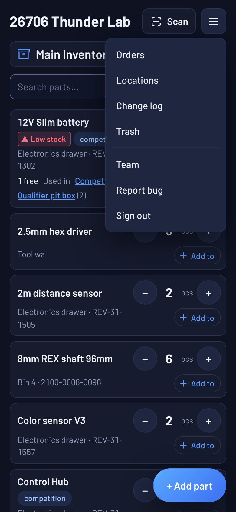

---

## 3. Add and change parts

Tap **+ Add part** and fill in what you know. Only the item name and quantity are required.

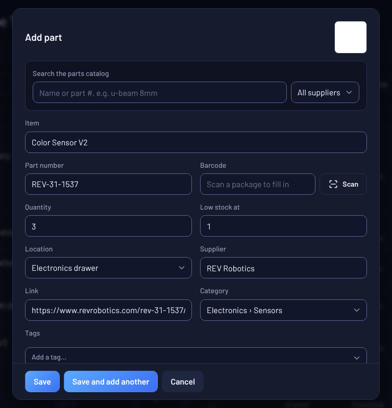

- **Type a goBILDA, REV, AndyMark, ServoCity, TETRIX or Studica part number** and the item name, supplier and product link fill in by themselves. Even faster: tap **Scan** next to Barcode and scan the barcode on the package.
- **Low stock at** flags the part once its quantity drops to that number or below (optional).
- **Location** comes from your team's list of locations (see [section 5](#5-locations-and-qr-labels)). Pick **+ New location…** to add one without leaving the part.
- **Category** can have subcategories: `Electronics/Sensors` shows as Electronics › Sensors.
- **Tags** are short labels like `spare` or `competition`. Tap a tag on any part to show only parts with that tag.
- **More details** holds the unit, condition and notes. It opens by itself on parts that have any of them.
- **Save and add another** keeps the location, category and tags for the next part, which is handy when you're entering a whole bin.
- If you're filtered to one location (or just scanned a bin's label), **+ Add part** starts in that location.

The app warns you before adding a part with the same name or part number as one you already have.

To change a part, tap it, edit, and **Save**. To change just the quantity, use **−** and **+** on the list. **Delete** is at the bottom of the part dialog; deleted parts go to [Trash](#10-change-log-undo-and-trash).

---

## 4. Find parts fast

Type in **Search** to narrow the list as you type. If parts in your other inventories match too, a line under the list says where (for example *Also found in Pit spares (2)*); tap it to search there. **Filters** opens more options:

- **Filter** by category, location or tag, or tap **Low stock** to see only parts that need restocking.
- **Sort** by any column, or by **Recently changed**.
- **Group** by category, location or supplier.

The Filters button shows how many filters are on, so you never forget one. **Reset filters** turns them all off.

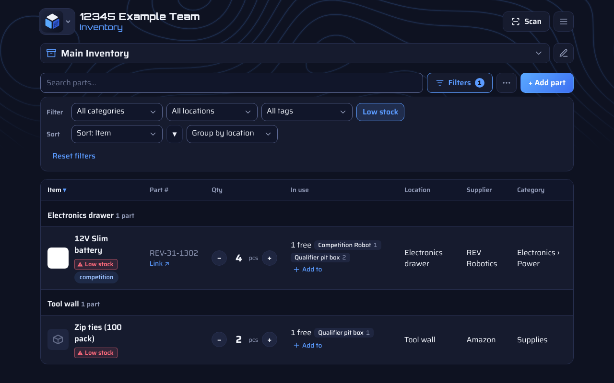

---

## 5. Locations and QR labels

Your team keeps one list of locations (bins, shelves, drawers). Open **☰ → Locations** to add, rename or delete them, or print one bin's label. A location can only be deleted if there are no parts assigned to it.

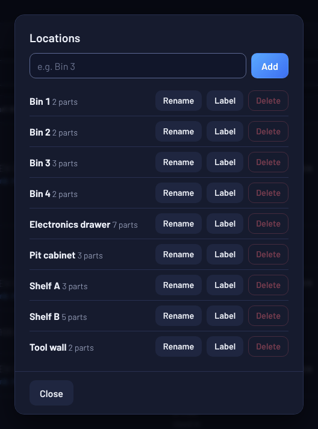

**QR labels** are printed from **⋯ → Print QR labels**. Stick them on bins and parts. Scanning one with the app's **Scan** button, or with any phone camera, opens that bin (showing just its parts) or that part, ready to take one with **−**.

The app remembers which labels you've printed, so only new ones are checked. The list follows your filters, so filter to one location first to print just its labels. A single part's label can also be printed from its dialog with **Print label**.

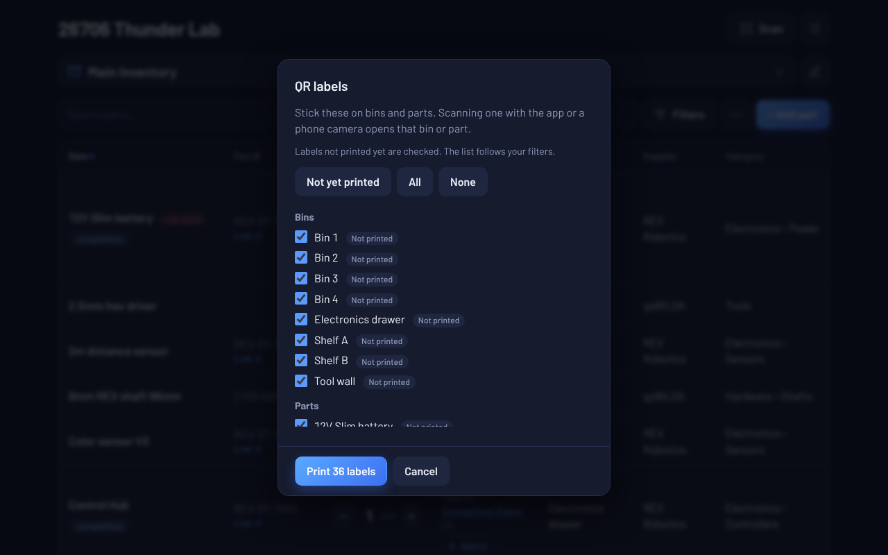

---

## 6. Inventories, projects and packing lists

Open the **list picker** at the top to switch views or make a new one with **New inventory, project or list**.

  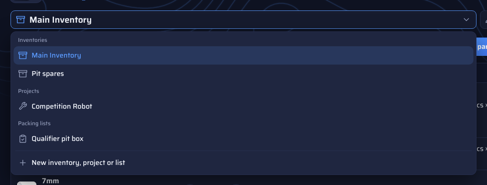
  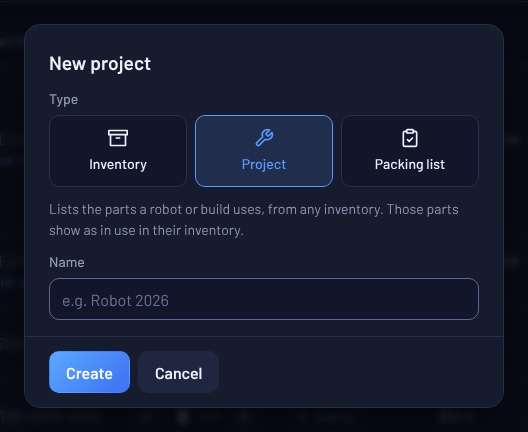

- **Inventory**: holds parts. Every team starts with **Main Inventory**, and you can add more (for example *Pit spares*).
- **Project**: the parts a robot or build uses, picked from any inventory. Parts used by a project stay in their inventory but show as **in use**, so the inventory shows how many are still free.
- **Packing list**: what to bring to a competition. Check parts off as you pack them. Only checked parts count as in use, so unchecking them when you get home frees them again. The list shows how many are packed (*Packed 3 of 7*), and **⋯ → Unpack all** unchecks everything at once after an event (it asks first, and **Undo** packs them again).

In a project or packing list, **+ Add parts** opens a list of every part in every inventory; tap a part to add one more. Use **−** and **+** to change how many it uses, or tap the part to type a number or remove it.

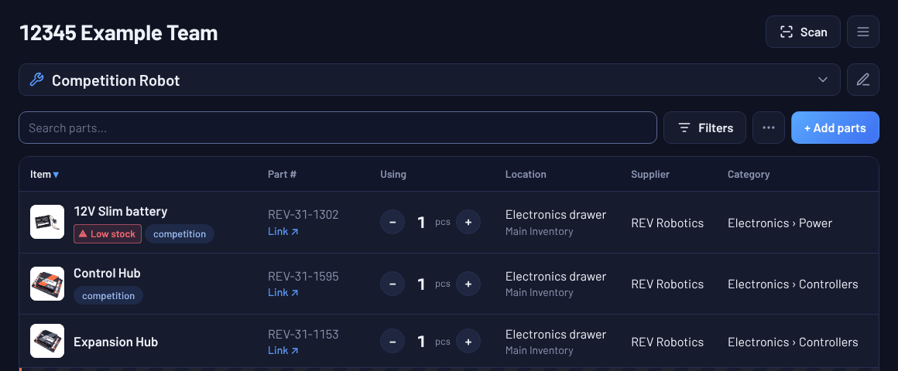

From the inventory, **Add to** on any part puts it straight into a project or packing list.

  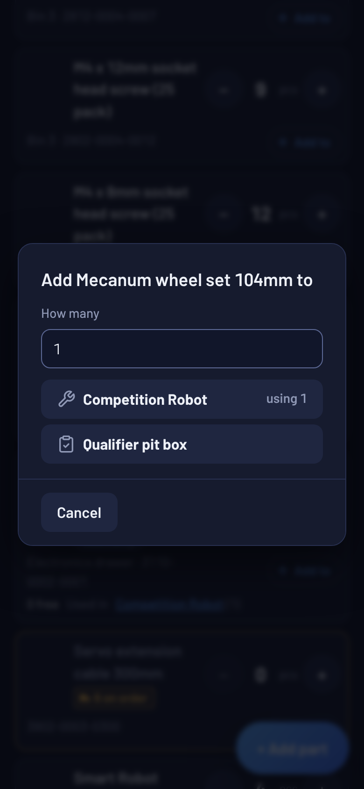
  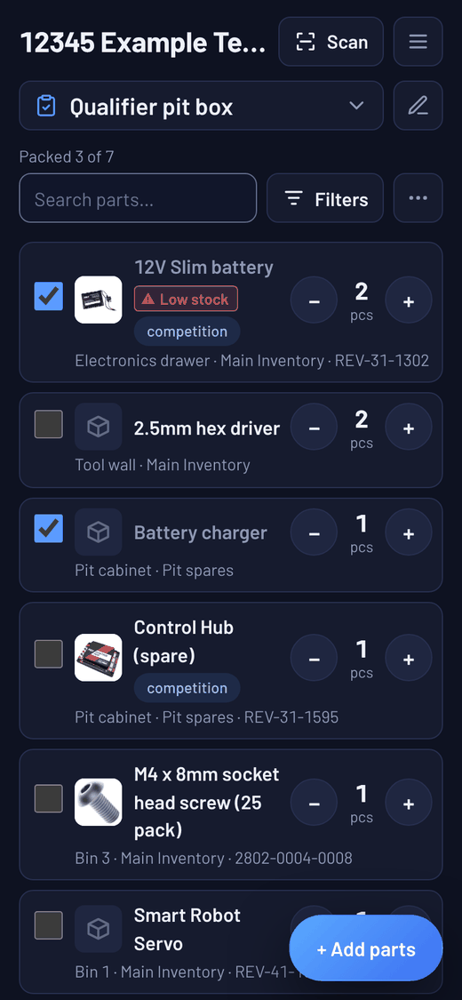

---

## 7. Order list

Open **☰ → Orders** to track parts you've ordered.

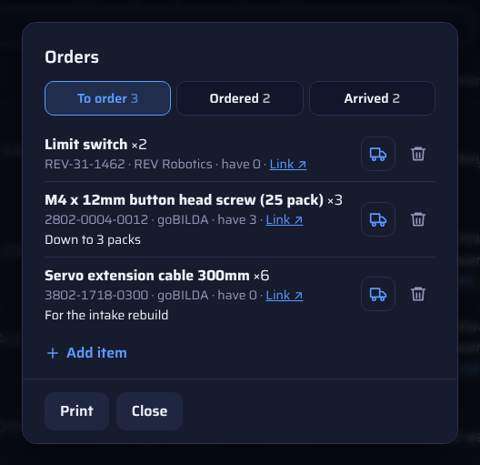

- Add an order by typing the item, or pick a part you already have. Typing a supported part number fills in the rest. A link and notes are optional.
- New items show up in Main Inventory right away as **on order**, so projects and packing lists can use them before they arrive.
- When a box comes in, tap **Arrived**. The parts are added to the inventory. If only some came, enter how many; the rest stays on the order list.
- Tap an order to change it. **Print** makes a paper copy of the list.

---

## 8. Edit many parts at once

Choose **⋯ → Select parts**, tap the parts you want (or **Select all shown** to take everything your search and filters show), then **Edit selected**. You can set the location, category, low-stock number and tags for all of them at once. Anything left on "Keep" stays as it is on each part.

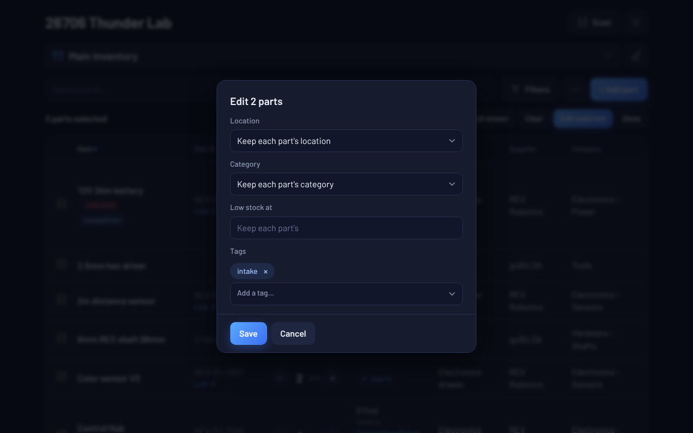

---

## 9. CSV export and import

In an inventory, the **⋯** menu has:

- **Export CSV**: saves every part in the inventory as a spreadsheet file, for a backup or to open in Excel or Google Sheets. Export works on the website and the Windows app, not the Android app.
- **Import CSV**: adds parts from a spreadsheet. The first row needs column names, with one called **Item**. Export a file first to see every column the app reads.

Before anything is added, the app shows what it found. Parts already in the inventory (same name or part number) are skipped, so nothing you already have is changed, and importing the same file twice adds nothing. **Undo** removes the whole import.

  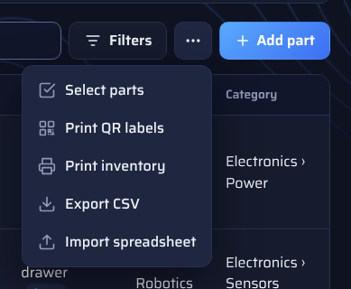
  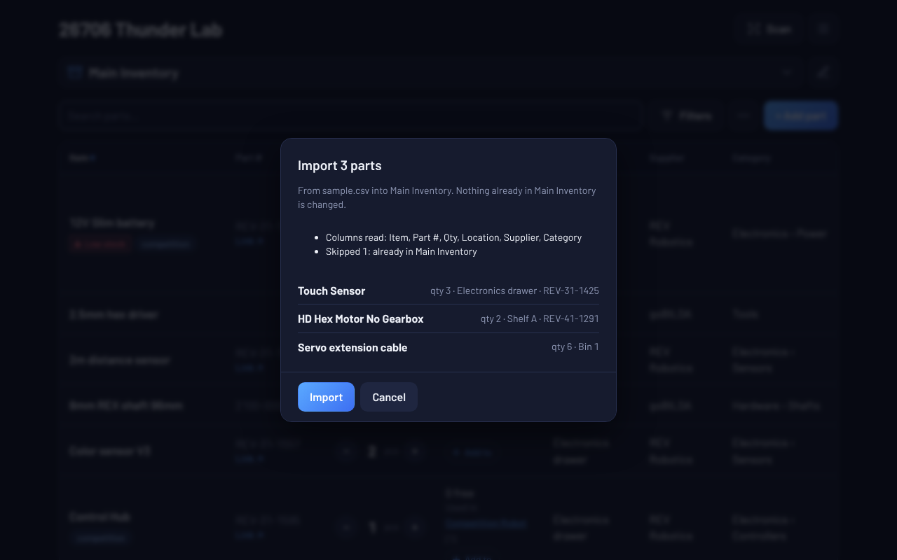

**Print list** in the same menu prints the parts on screen, grouped the same way.

---

## 10. Change log, Undo and Trash

- **Undo**: after most changes, an **Undo** button shows at the bottom of the screen for a few seconds.
- **☰ → Change log** shows who added, changed, used, received or deleted what, and when.
- **☰ → Trash** keeps deleted parts, projects, packing lists and orders for 30 days. Tap **Restore** to bring one back. Only the team owner can **Delete forever**.

  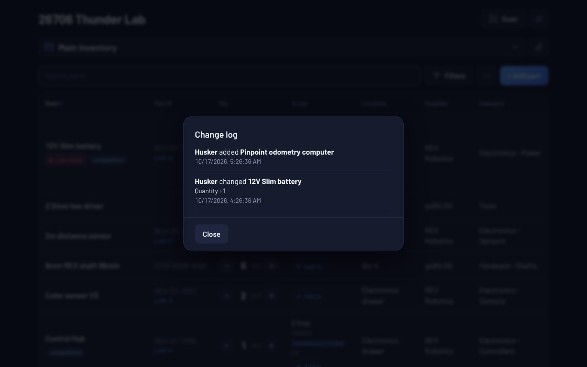
  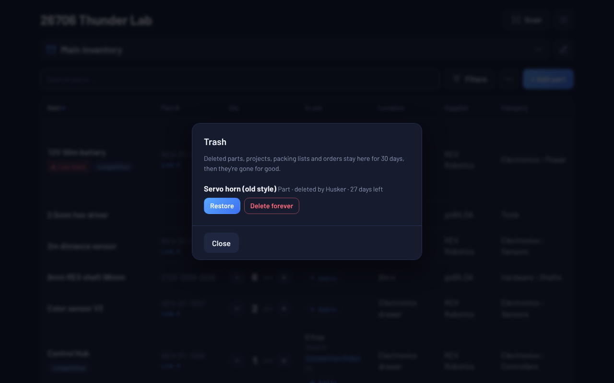

---

## 11. Team, sign out and other tips

- **☰ → Team** shows the join QR code and code, lets you change **your name**, and lists the members. The team owner can remove members, **Reset join code** if it was shared by mistake, and delete the team (see the [team admin guide](ADMIN.md)).
- **Works offline.** No wifi at the venue? Keep editing. Changes are saved on the device and sync when it's back online. The website opens offline too, after it has been used online once.
- **Everyone sees changes live**, so two people can count parts at the same time from different devices.
- **Blue banner saying your Firebase rules are out of date?** Your team's admin needs to [update the rules](../SETUP.md#updating-the-rules). The app will keep working in the meantime, but some new features may not work correctly until your Firebase rules are up to date.
- **A banner or message you don't understand?** [Troubleshooting and FAQ](TROUBLESHOOTING.md) explains each one and how to fix it.
- **☰ → Report bug** logs a short description of the problem to a central server, with your team name and app version. Please don't include personal info.
- **☰ → Request feature** sends an idea for the app to its developer the same way.
- **☰ → Pain and suffering mode** is a switch for a light theme. Turn it off to go back to Normal mode. Each device remembers its own choice.
- **☰ → Sign out** also removes the team's data saved on that device, which is good practice on a shared computer.
